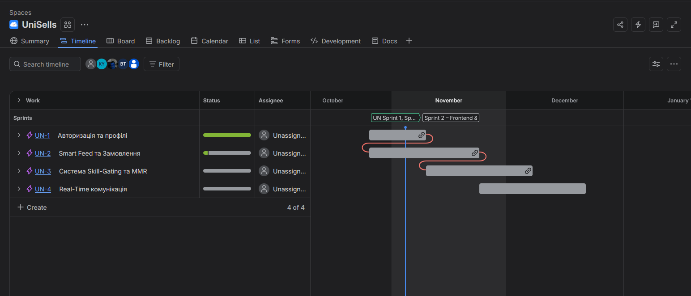
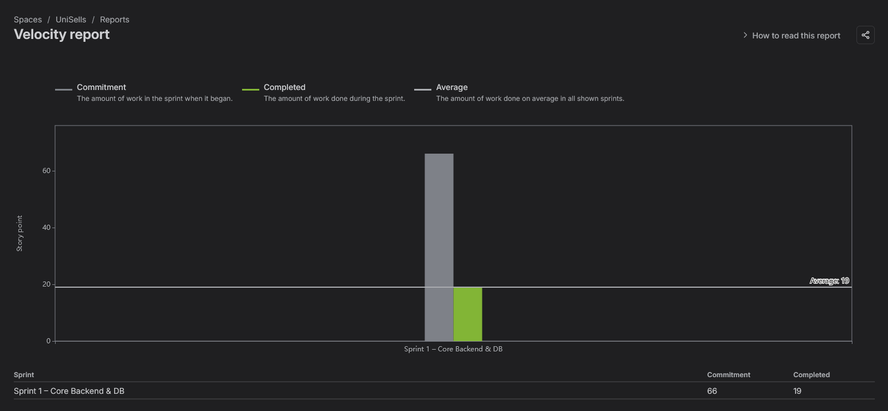
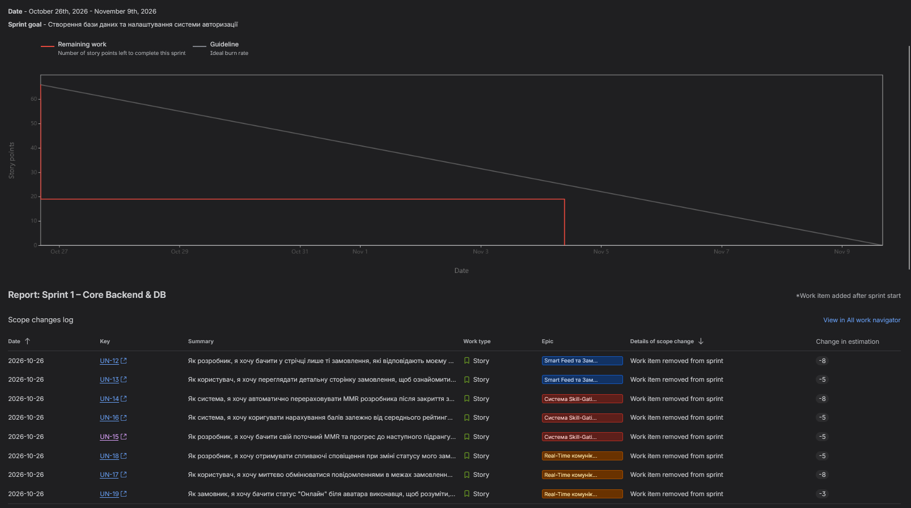
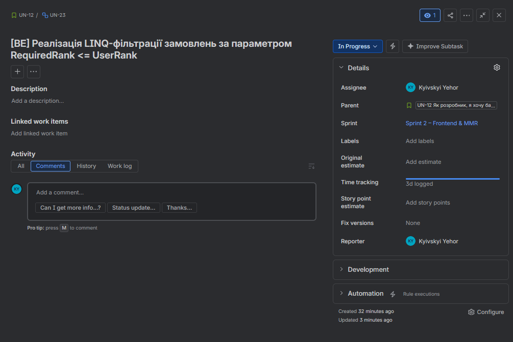
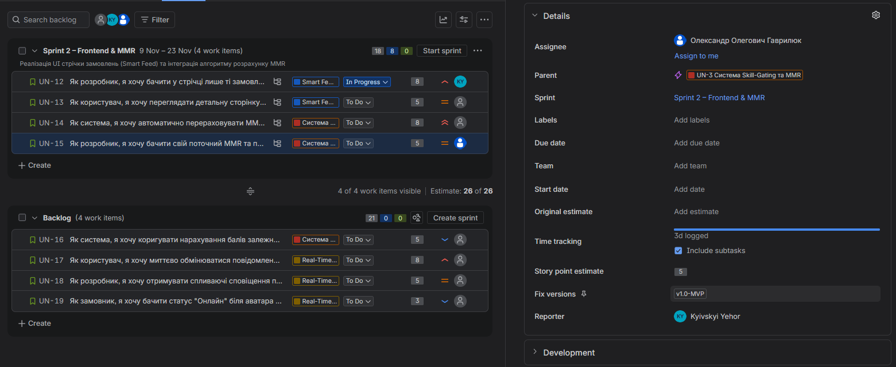

# План часу та вартості проєкту UniSells

**Команда:** Єгор К., Богдан М., Богдан Т., Олександр Г. | **Jira:** https://kievskijegor.atlassian.net/jira/software/projects/UN/boards/3 | **Дата:** 04.11.2026

---

## 1. Вихідні дані з Jira

| Параметр | Значення | Джерело в Jira |
|---|---|---|
| Загальний обсяг беклогу | 66 SP | Backlog → сума SP (19 SP у Sprint 1 + 47 SP у Backlog) |
| Velocity Sprint 1 | 19 SP | Reports → Velocity Chart |
| Кількість членів команди | 4 | Project → People |
| Годин у спринті на особу | 40 год | 2 тижні × 5 днів × 4 год |
| Годин на 1 SP | 4 год | Σ Original Estimate ÷ SP (Крок 3) |
| Погодинна ставка | $15 | Умовна |

---

## 2. Критичний ланцюжок

| # | Issue Key | Story | SP | Блокує |
|:-:|---|---|:---:|---|
| 1 | UN-8 | Як новий користувач, я хочу реєструватися на платформі з вибором ролі, щоб почати працювати як замовник або розробник | 5 | UN-9, UN-11 |
| 2 | UN-11 | Як замовник, я хочу створювати нове замовлення із зазначенням мінімального рангу, щоб відсіяти некваліфікованих виконавців | 8 | UN-12 |
| 3 | UN-12 | Як розробник, я хочу бачити у стрічці лише ті замовлення, які відповідають моєму рангу, щоб не витрачати час на недоступні завдання | 8 | UN-14 |
| 4 | UN-14 | Як система, я хочу автоматично перераховувати MMR розробника після закриття замовлення, щоб його рейтинг завжди був актуальним | 8 | UN-15 |
| 5 | UN-15 | Як розробник, я хочу бачити свій поточний MMR та прогрес до наступного підрангу (зірки), щоб розуміти свій статус на платформі | 5 | Release v1.0-MVP |
| | **Разом** | | **34 SP** | |

| Epic / Story з резервом часу (Float) | Чому не на критичному шляху |
|---|---|
| UN-10 (Налаштування стека у профілі, 3 SP) | Може виконуватися паралельно після реєстрації, не блокує створення замовлень або розрахунок MMR |
| UN-4 (Епік: Real-Time комунікація — UN-17, UN-18, UN-19, 16 SP) | Чат на SignalR та онлайн-статуси не блокують роботу ядра Smart Feed і математичної моделі MMR |

---

## 3. Прогноз тривалості

| Показник | Формула | Значення |
|---|---|:---:|
| Кількість спринтів | Обсяг беклогу ÷ Velocity | 66 ÷ 19 = 3.47 |
| Округлено | ↑ | 4 спринти |
| Дата початку Sprint 1 | з Jira | 26.10.2026 |
| Дата релізу v1.0-MVP | Кінець Sprint 4 (8 тижнів) | 21.12.2026 |
| Чи вкладаємось у семестр? | До кінця грудня 2026 | Так |

---

## 4. Вартість команди

| Показник | Формула | Значення |
|---|---|:---:|
| Team Cost per Sprint | 4 осіб × 40 год × $15 | $2,400 |
| Вартість 1 SP | Team Cost ÷ Velocity ($2,400 ÷ 19) | $126.32 |
| Вартість 1 години | ставка | $15 |

---

## 5. Вартість по Epics

| Epic | Issue Key | SP | Вартість | Fix Version | Пріоритет |
|---|---|:---:|---|---|---|
| Авторизація та профілі | UN-1 | 11 | $1,389.52 | v1.0-MVP | Must / Should |
| Smart Feed та Замовлення | UN-2 | 21 | $2,652.72 | v1.0-MVP | Must / Should |
| Система Skill-Gating та MMR | UN-3 | 18 | $2,273.76 | v1.0-MVP (13 SP) / v1.1 (5 SP) | Must / Should / Could |
| Real-Time комунікація | UN-4 | 16 | $2,021.12 | v1.0-MVP (13 SP) / v1.1 (3 SP) | Must / Should / Could |
| **Разом** | | **66 SP** | **$8,337.12** | | |

---

## 6. Бюджет проєкту

| Компонент | Розрахунок | Сума |
|---|---|---:|
| Оцінка беклогу | 66 SP × $126.32 | $8,337.12 |
| Contingency Reserve | 10% від оцінки | $833.71 |
| **Working Budget** | оцінка + contingency | **$9,170.83** |
| Management Reserve | 15% від Working Budget | $1,375.62 |
| **Total Budget** | Working + Management | **$10,546.45** |

---

## 7. Earned Value за Sprint 1

| Метрика | Розрахунок | Значення | Джерело в Jira |
|---|---|---:|---|
| PV (Planned Value) | 19 SP × $126.32 | $2,400.00 | Sprint Report → Committed (19 SP) |
| EV (Earned Value) | 19 SP × $126.32 | $2,400.00 | Sprint Report → Completed (19 SP) |
| AC (Actual Cost) | 4 особи × 38 год × $15 (152 год) | $2,280.00 | Оцінка фактично відпрацьованих годин команди |
| **CV (Cost Variance)** | EV − AC ($2,400 − $2,280) | +$120.00 | Економія бюджету |
| **SV (Schedule Variance)** | EV − PV ($2,400 − $2,400) | $0.00 | Точно за графіком |
| **CPI (Cost Performance Index)** | EV ÷ AC ($2,400 ÷ $2,280) | 1.05 | Висока ефективність витрат |
| **SPI (Schedule Performance Index)** | EV ÷ PV ($2,400 ÷ $2,400) | 1.00 | Повне виконання плану спринту |
| **EAC (Estimate at Completion)** | Total Budget ÷ CPI ($10,546.45 ÷ 1.05) | $10,044.24 | Прогнозований підсумковий бюджет |

| Індекс | Значення | Стан | Інтерпретація |
|---|:---:|:---:|---|
| CPI | 1.05 | 🟢 | Проєкт виконується в межах бюджету (економія $120 за перший спринт) |
| SPI | 1.00 | 🟢 | Команда закрила всі 19 SP згідно з розкладом без затримок |

> 🟢 ≥ 1.0 | 🟡 0.9–1.0 | 🔴 < 0.9

---

## 8. Скріншоти

### 1. Roadmap з залежностями між Epics

### 2. Velocity Chart

### 3. Burndown Chart Sprint 1

### 4. Story з Subtasks і Time Tracking

### 5. Releases (v1.0-MVP, v1.1)

---

## 9. Рефлексія

| Питання | Відповідь команди |
|---|---|
| Наскільки оцінка в годинах (Subtasks) збіглась зі Story Points? Який коефіцієнт вийшов? | Декомпозиція задач на технічні Subtasks ([BE], [FE], [QA], [Design]) показала стабільне співвідношення: **1 SP = 4 робочі години** (наприклад, задача на 5 SP вимагає рівно 20 годин роботи, а задача на 8 SP — 32 години). |
| Чи змінилось розуміння термінів після розрахунку через Velocity? Встигаєте до кінця семестру? | Так, маючи реальний Velocity 19 SP за перший спринт та загальний обсяг беклогу 66 SP, команда чітко бачить, що проєкт потребує 3.47 (округлено 4) спринти. Ми повністю вкладаємося у семестр і виходимо на реліз v1.0-MVP до 21 грудня 2026 року. |
| Що показав CPI/SPI за Sprint 1 і що команда зробить інакше у Sprint 2? | Індекс SPI = 1.00 підтвердив реалістичність планування першого спринту, а CPI = 1.05 показав невелику економію часу (витрачено 152 год замість планових 160 год). Оскільки у Sprint 1 поле Time Spent не заповнювалося під час роботи, AC розраховано за фактично відпрацьованими годинами команди — головним уроком для Sprint 2 є щоденне логування часу (Work Log) у кожному Subtask. |
| Яка залежність виявилась найнебезпечнішою для проєкту? | Найбільш критичним вузьким місцем є задача **UN-11 (Створення замовлення)** та **UN-12 (Фільтрація Smart Feed за рангом)**, оскільки без їх завершення неможливо протестувати та запустити ядро системи — математичний перерахунок рейтингу MMR (UN-14). |
