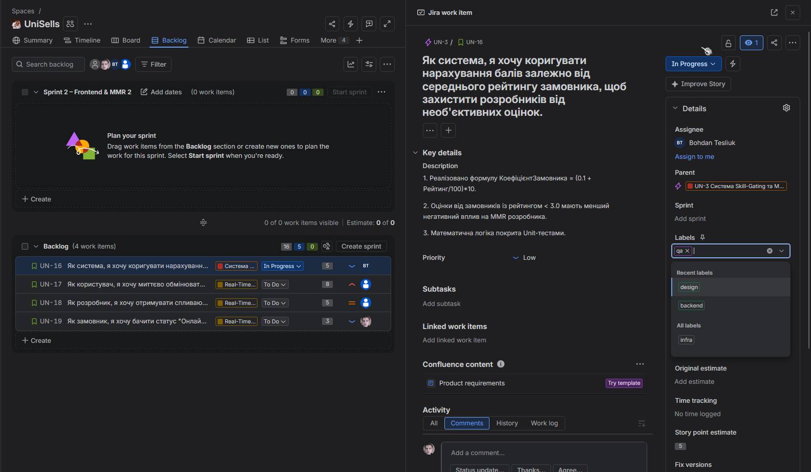
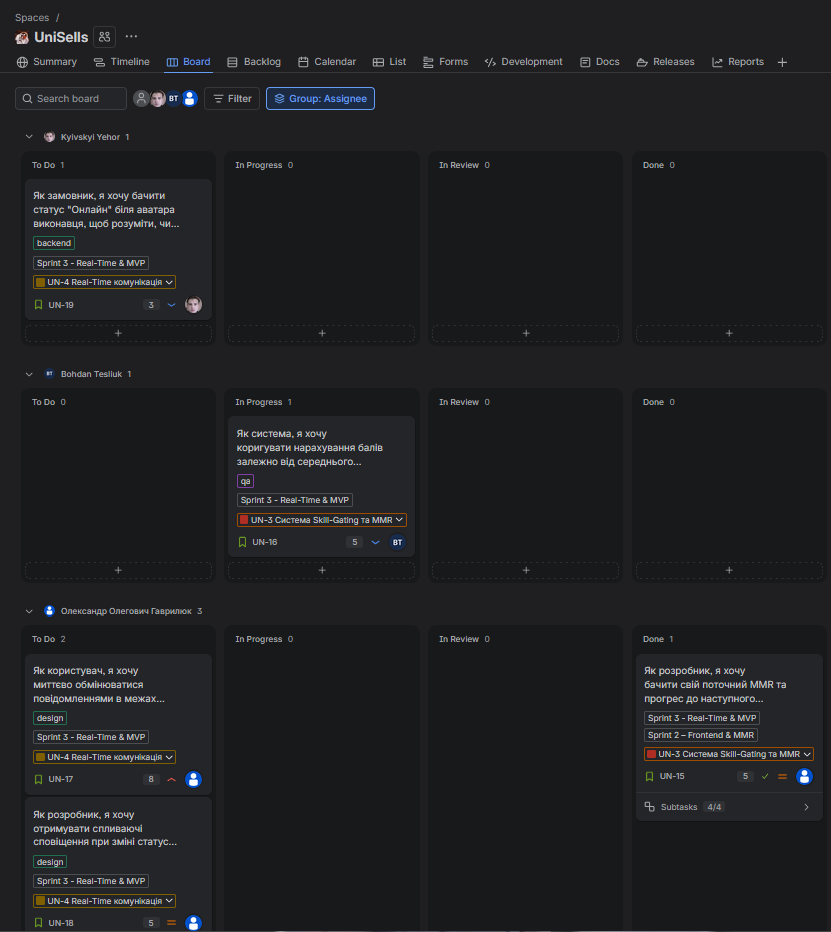
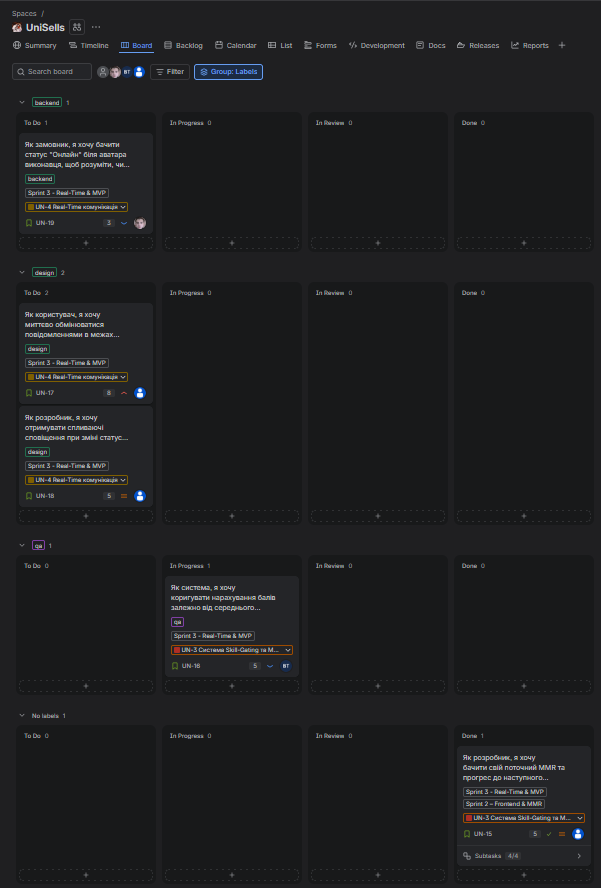
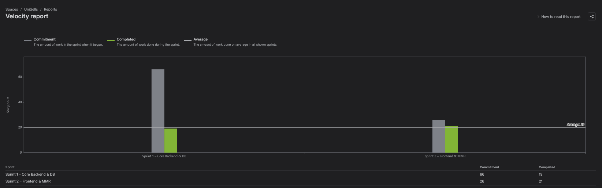
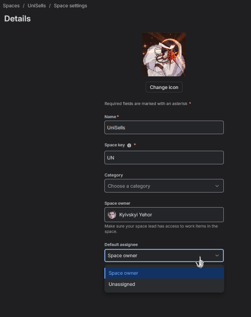

# Управління ресурсами проєкту UniSells

## 2.1. Склад команди
| Учасник | Ролі в проєкті | Доступність (FTE) | Годин на тиждень |
|---|---|---|---|
| Богдан М. | PM + Infra | 0.25 | 10 |
| Богдан Т. | PO + QA | 0.25 | 10 |
| Єгор К. | Developer (Backend + Frontend) | 0.4 | 16 |
| Олександр Г.| Designer | 0.2 | 8 |

## 2.2. Capacity на спринт
| Параметр | Значення | Коментар |
|---|---|---|
| Тривалість спринту | 2 тижні | |
| Σ годин команди на спринт | 88 год | З таблиці 2.1 ((10+10+16+8)*2) |
| Коефіцієнт на непродуктивний час | -20% | Мітинги, планування, рев'ю |
| **Ефективна Capacity** | **~70 год** | |
| Velocity (факт, Sprint 1) | 19 SP | З Velocity report |
| Годин на 1 SP | ~3.6 год/SP | Capacity ÷ Velocity |
| **Плановий обсяг наступного спринту** | **~19-20 SP** | З урахуванням доступності |

## 2.3. Skills Matrix
*Оцінка: 0 — немає, 1 — базовий, 2 — впевнений, 3 — сильний.*

| Навичка | Єгор | Богдан М. | Богдан Т. | Олександр | Потрібний рівень | Ризик |
|---|---|---|---|---|---|---|
| React / Frontend | 3 | 0 | 0 | 1 | ≥2 | Високий |
| .NET / Backend | 3 | 0 | 0 | 0 | ≥2 | Високий |
| БД (PostgreSQL) | 3 | 1 | 0 | 0 | ≥2 | Високий |
| Тестування (QA) | 1 | 1 | 2 | 0 | ≥1 | Низький |
| DevOps / Jira | 1 | 2 | 1 | 0 | ≥1 | Низький |
| UI/UX Дизайн | 0 | 0 | 1 | 3 | ≥2 | Середній |

## 2.4. Аналіз Skills Matrix
| Питання | Відповідь |
|---|---|
| Яка навичка покрита лише однією людиною? | Backend (.NET), Frontend (React) та Дизайн покриті вузькими спеціалістами. |
| Який Bus Factor у критичних зонах? | 1 (якщо Єгор випадає з процесу, вся технічна розробка зупиняється). |
| Яка навичка потрібна, але відсутня/слабка? | Тестування коду (Unit-тести) та автоматизація деплою. |
| План закриття розриву | Богдан М. (PM) буде глибше вивчати процеси DevOps, а Богдан Т. (PO) — ручне тестування API (Postman). |

## 2.5. Зони відповідальності (Labels)  
| Label | Area Lead | К-сть задач | Що входить |
| :--- | :--- | :--- | :--- |
| backend | Єгор К. | 3 | API, БД, SignalR, алгоритми MMR (UN-16, UN-17, UN-19) |
| frontend | Єгор К. | 2 | UI, форми, Bootstrap Toasts, логіка React (UN-15, UN-18) |
| design | Олександр Г. | 0 | Макети інтерфейсів, лого, UX |
| qa | Богдан Т. | 0 | Тестування функціоналу, перевірка Acceptance Criteria |
| infra | Богдан М. | 0 | Налаштування Jira, GitHub, документація |

## 2.6. Аналіз Workload (з Jira)
| Учасник | Задач у спринті | SP committed | SP done (поки що) | % виконання | Висновок |
| :--- | :--- | :--- | :--- | :--- | :--- |
| Єгор К. | 1 | 3 SP | 0 SP | 0% | Недовантажений |
| Олександр Г. | 3 | 18 SP | 5 SP | 27% | Критично перевантажений |
| Богдан Т. | 1 | 5 SP | 0 SP | 0% | В нормі |
| Богдан М. | 0 | 0 SP | 0 SP | 0% | Недовантажений (немає задач у спринті) |

## 2.7. Вирівнювання завантаження
| Виявлена проблема | Рішення | Результат |
| :--- | :--- | :--- |
| Дизайнер (Олександр) критично перевантажений задачами з розробки (18 SP), тоді як єдиний розробник (Єгор) має лише 3 SP. Виконавці не відповідають своїм Area Leads. | Для вирівнювання завантаження та дотримання зон відповідальності задачі UN-15, UN-17 та UN-18 потрібно перепризначити на Єгора, а задачу UN-16 (якщо це бекенд) — також на нього або перевести в статус тестування (QA) для Богдана. | Баланс буде відновлено, Assignee збігатиметься з Area Lead. |

## 2.8. Ресурсний план по спринтах
| Спринт | Період | Потрібні зони | Capacity (год) | Особливості |
|---|---|---|---|---|
| Sprint 2 | 4 Nov – 23 Nov | backend, frontend, qa | ~70 | Інтеграція SignalR та алгоритмів MMR. |
| Sprint 3 | 24 Nov – 7 Dec | backend, frontend, qa | ~70 | Багфікс та підготовка до MVP. |
| Sprint 4 | 8 Dec – 21 Dec | qa, infra | ~40 | Початок сесії, Capacity команди падає. |

## 2.9. Скріншоти з Jira
### 1. Backlog з Labels
_Видимі кольорові мітки технічних зон на картках задач._

---

### 2. Board по Assignee
_Дошка з групуванням задач по виконавцях (аналіз завантаженості команди)._

---

### 3. Board по Labels
_Дошка з групуванням задач по мітках (аналіз обсягу робіт у кожній зоні)._

---

### 4. Velocity report
_Графік швидкості команди (співвідношення запланованих та виконаних SP)._

---

### 5. Space settings → Details
_Налаштування простору з виставленим виконавцем за замовчуванням._

## 2.10. Висновки команди
*   **Хто перевантажений/недовантажений:** Згідно з даними Sprint 3, дизайнер Олександр Гаврилюк перевантажений (взяв 18 SP технічних задач). Єгор Київський (Developer) недовантажений (всього 3 SP).
*   **Bus Factor:** Bus Factor дорівнює 1. Якщо Єгор випадає, розробка зупиняється. Поточний розподіл в Jira (де задачі розробки висять на дизайнері та PO) є тимчасовим дисбалансом планування.
*   **Реалістичність:** Запланована кількість у 26 SP на цей спринт є дещо завищеною порівняно з нашою Velocity (19 SP), тому є ризик не встигнути закрити всі задачі.
*   **Найбільша зона:** Найбільше задач (3 задачі, 16 SP) сконцентровано у зоні `backend`. Це не відповідає кількості людей у ній (1 розробник), що підтверджує нестачу технічних ресурсів у команді.
